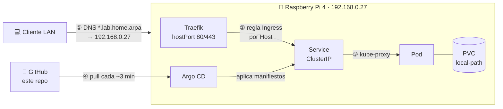

<div align="center">

# 🍓 K3s + GitOps en Raspberry Pi

**Clúster Kubernetes ligero en una Raspberry Pi 4, gestionado de forma declarativa con Argo CD.**
Git es la única fuente de verdad: un commit en este repositorio basta para cambiar lo que corre en el clúster.


</div>

---

## 📌 Qué es

Proyecto de laboratorio para practicar la administración de un clúster Kubernetes **real**, con las prácticas que se usan en producción, sobre un hardware muy limitado (4 núcleos ARM y 4 GB de RAM):

- **Kubernetes ligero (K3s)** instalado y ajustado a mano: cgroups, kernel y reserva de recursos.
- **Ingress con Traefik** para publicar varias aplicaciones por dominio a través de un único puerto.
- **GitOps con Argo CD:** el clúster se sincroniza solo con este repositorio y corrige cualquier cambio manual.
- **Límites de CPU y memoria** en todas las cargas, para que ninguna aplicación tumbe la Pi.
- **Documentación paso a paso**, incluidos los problemas reales encontrados y cómo se diagnosticaron.

## 🏗️ Arquitectura



| Red | Rango | Uso |
|---|---|---|
| LAN | `192.168.0.0/24` | Red de casa; la Pi tiene IP fija `192.168.0.27` |
| Pods | `10.42.0.0/16` | IP interna de cada contenedor (flannel) |
| Services | `10.43.0.0/16` | IP virtual estable de cada servicio |

**Recorrido de una petición:**

1. El DNS resuelve `app.lab.home.arpa` a la IP de la Pi.
2. Traefik la recibe en el puerto 80 y elige el Service según la cabecera `Host`.
3. kube-proxy la entrega a uno de los pods del Service.
4. Por su parte, Argo CD vigila GitHub y aplica en el clúster cualquier cambio que se suba.

## 🧰 Stack

| Capa | Tecnología | Por qué |
|---|---|---|
| Hardware | Raspberry Pi 4 Model B (4 GB) | Recursos limitados que obligan a ajustar bien |
| Sistema | Raspberry Pi OS 64-bit (Debian 13), con el escritorio desactivado | Base estable; la RAM queda para Kubernetes |
| Kubernetes | K3s `v1.37.2+k3s1` | Distribución certificada por la CNCF, un solo binario |
| Ingress | Traefik 3.7 con `hostPort` | Incluido en K3s; sin balanceador externo |
| Almacenamiento | `local-path-provisioner` | Volúmenes persistentes en el disco del nodo |
| GitOps | Argo CD v3.6.1 (patrón *app-of-apps*) | Sincronización automática con *self-heal* y *prune* |
| Métricas | metrics-server | `kubectl top` para CPU y memoria |

## 📈 Estado del proyecto

| # | Parte | Estado |
|---|---|---|
| 1 | [Preparación de la Raspberry Pi](docs/01-preparacion-pi.md): acceso SSH por clave, cgroups, swap, kernel | ✅ Hecho |
| 2 | [Instalación de K3s](docs/02-instalacion-k3s.md): Traefik con hostPort, reserva de recursos, kubectl remoto | ✅ Hecho |
| 3 | GitOps con Argo CD: instalación, app-of-apps, sincronización automática | 🚧 En curso |
| 4 | Aplicación de ejemplo con almacenamiento persistente, `requests`/`limits` e Ingress | ⏳ Pendiente |
| 5 | Monitorización y guía de troubleshooting | ⏳ Pendiente |

## 🔧 Retos resueltos

| Reto | Solución |
|---|---|
| El kernel de la Pi trae **desactivado el cgroup de memoria**, así que Kubernetes no puede limitar la RAM | `cgroup_memory=1 cgroup_enable=memory` en `cmdline.txt` ([1.5.4](docs/01-preparacion-pi.md)) |
| **kube-proxy no arrancaba:** `iptables: Failed to initialize nft` | Diagnóstico con `modprobe` y `dpkg -V`: paquete del kernel dañado por una actualización interrumpida (64 ficheros perdidos). Se reinstaló y verificó ([2.4](docs/02-instalacion-k3s.md)) |
| Sin ServiceLB, Traefik quedaba en `<pending>` | `hostPort` 80/443 y `service.spec.type: ClusterIP` (opción renombrada en el chart v41) ([2.5](docs/02-instalacion-k3s.md)) |
| Con `hostPort` en un solo nodo, las actualizaciones de Traefik se bloquean | Estrategia `maxSurge: 0` / `maxUnavailable: 1` |
| Sin LoadBalancer, los Ingress no tienen dirección y Argo CD los ve `Progressing` | `ingressEndpoint.ip` con la IP del nodo |
| Proteger el nodo frente a cargas que consumen toda la RAM | `system-reserved`, `kube-reserved` y `eviction-hard` en el kubelet |

## 📁 Estructura del repositorio

```
k3s-gitops-rpi/
├── README.md
├── bootstrap/                 # se aplica a mano UNA vez, antes del GitOps
│   ├── k3s-config.yaml        #   → /etc/rancher/k3s/config.yaml
│   └── traefik-config.yaml    #   → /var/lib/rancher/k3s/server/manifests/
└── docs/                      # documentación detallada, paso a paso
    ├── 01-preparacion-pi.md
    └── 02-instalacion-k3s.md
```

## 🚀 Cómo reproducirlo

1. **Preparar la Pi:** sigue [docs/01-preparacion-pi.md](docs/01-preparacion-pi.md).
2. **Instalar K3s:** copia los ficheros de `bootstrap/` a sus rutas de destino y ejecuta:
   ```bash
   curl -sfL https://get.k3s.io -o k3s-install.sh
   sudo INSTALL_K3S_VERSION="v1.37.2+k3s1" sh k3s-install.sh
   ```
   El detalle está en [docs/02-instalacion-k3s.md](docs/02-instalacion-k3s.md).
3. **GitOps:** en construcción.

---

<div align="center">
<sub>Proyecto personal de laboratorio · Administración de Sistemas y Redes · DevOps</sub>
</div>
