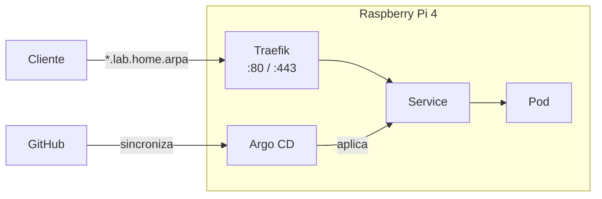

<div align="center">

# K3s + GitOps en Raspberry Pi

**Clúster Kubernetes ligero en una Raspberry Pi 4, gestionado con Argo CD.**
Un commit en este repositorio basta para cambiar lo que corre en el clúster.


</div>

## Qué es

Un laboratorio para administrar un clúster Kubernetes con prácticas de producción sobre hardware limitado:

- **K3s** instalado y ajustado a mano en una Raspberry Pi 4.
- **Traefik** para publicar las aplicaciones por dominio.
- **Argo CD** para desplegar todo desde Git (GitOps).

## Arquitectura



## Stack

| Capa | Tecnología |
|---|---|
| Hardware | Raspberry Pi 4 Model B (4 GB) + SSD por USB 3 |
| Sistema | Raspberry Pi OS 64-bit (Debian 13) |
| Kubernetes | K3s v1.37.2 |
| Ingress | Traefik 3.7 |
| GitOps | Argo CD v3.6.1 |
| Aplicación de ejemplo | Uptime Kuma 2.5 con disco persistente |

## Documentación

1. [Preparación de la Raspberry Pi](docs/01-preparacion-pi.md)
2. [Instalación de K3s](docs/02-instalacion-k3s.md)
3. [GitOps con Argo CD](docs/03-gitops-argocd.md)
4. [Aplicación de ejemplo: Uptime Kuma](docs/04-aplicacion-uptime-kuma.md)

## Estructura

```
k3s-gitops-rpi/
├── bootstrap/   # configuración inicial, se aplica a mano una vez
├── apps/        # aplicaciones de Argo CD (una por fichero)
├── platform/    # configuración del clúster gestionada por Argo CD
├── workloads/   # manifiestos de las aplicaciones
└── docs/        # documentación paso a paso
```

## Puesta en marcha

```bash
# 1. Instalar K3s (con los ficheros de bootstrap/ ya copiados en la Pi)
curl -sfL https://get.k3s.io | INSTALL_K3S_VERSION="v1.37.2+k3s1" sh -

# 2. Instalar Argo CD
kubectl create namespace argocd
kubectl apply -n argocd --server-side --force-conflicts \
  -f https://raw.githubusercontent.com/argoproj/argo-cd/v3.6.1/manifests/install.yaml

# 3. Arrancar el GitOps
kubectl apply -f bootstrap/root-app.yaml
```
